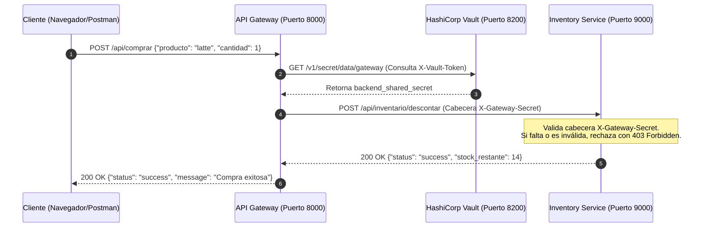

Integrantes: Freddy Jeldres, Matias Castillo

# ☕ Sistema Backend Seguro "Aroma & Café"

Este repositorio contiene la solución técnica y documental completa para la evaluación de **Arquitectura de Software, Microservicios y Seguridad de APIs** correspondiente al proyecto de la cafetería **Aroma & Café**.

El proyecto implementa una arquitectura desacoplada orientada a microservicios contenerizados utilizando **FastAPI** (Python), **Docker Compose** para la orquestación de infraestructura y **HashiCorp Vault** como gestor centralizado de secretos y credenciales de integración.

---

## 🏛 Módulos 1 al 3: Arquitectura, Modelos y Contratos de Integración

### 1. Mapa de Subsistemas y Componentes (Módulo 1)
La solución adopta el patrón de diseño **API Gateway**, aislando la lógica de negocio interna en microservicios especializados conectados a través de una red privada virtualizada (`aroma-network`):

* **API Gateway (Puerto 8000):** Único punto de contacto expuesto al tráfico externo (público). Es responsable del enrutamiento de solicitudes, agregación de respuestas y mediación de seguridad.
* **Inventory Service (Puerto 9000):** Microservicio privado encargado de gestionar el catálogo de productos y el stock disponible. No posee puerto de acceso directo desde el exterior.
* **Orders Service (Subsistema de Órdenes):** Encargado de la creación y seguimiento de los pedidos generados por los clientes.
* **Clients & Payments (Clientes y Pagos):** Módulos auxiliares dedicados a la gestión de perfiles de usuario y procesamiento seguro de transacciones.
* **HashiCorp Vault (Puerto 8200):** Servidor centralizado de secretos para almacenar y aprovisionar llaves criptográficas de forma dinámica.

> **Explicación del Diagrama de Componentes:** 
> El diagrama de componentes refleja una topología de red perimetral donde el **API Gateway** filtra todas las comunicaciones entrantes. Ningún cliente externo puede entablar conexión directa con *Inventory*, *Orders*, *Clients* o *Payments*; toda interacción es redirigida y validada primeramente por la capa del Gateway.

---

### 2. Diagrama de Secuencia y Flujo de Compra (Módulo 2)
El siguiente flujo describe la interacción asíncrona y los pasos de validación de seguridad durante una compra:



> **Explicación del Diagrama de Secuencia:**
> 1. El usuario inicia la transacción enviando una orden al endpoint público `POST /api/comprar`.
> 2. El **API Gateway** autentica su comunicación consultando a **HashiCorp Vault** para obtener la credencial compartida `backend_shared_secret`.
> 3. El Gateway inyecta la cabecera HTTP `X-Gateway-Secret` y realiza la llamada interna al **Inventory Service** para efectuar el descuento de inventario.
> 4. El microservicio de Inventario valida que la firma coincida con su secreto interno (`INTERNAL_GATEWAY_SECRET`). Al verificar la autenticidad, descuenta las unidades solicitadas y retorna la confirmación en formato JSON (`200 OK`).

---

### 3. Diagrama de Clases de Dominio y DTOs (Módulo 3)
El modelo de datos se estructura separando los objetos de transferencia de datos (DTOs) de las entidades del dominio de negocio:

* **Clases DTO:** `OrdenRequestDTO` y `ProductoDTO` encapsulan las solicitudes HTTP entrantes y garantizan la correcta validación de tipos mediante esquemas de Pydantic.
* **Clases de Dominio:** `Cliente`, `Pedido`, `Detalle pedido` y `Producto` representan los objetos persistentes del sistema. La relación de composición entre `Pedido` y `Detalle pedido` asegura la integridad referencial de los ítems adquiridos.

---

## 🔒 Módulos 4 al 6: Seguridad, Control de Accesos y Secretos

### 1. Matriz de Permisos HTTP (RBAC - Role-Based Access Control)

| Rol / Actor | Servicio de Red | Endpoint | Método | Decisión | Fundamento y Alcance de Seguridad |
| :--- | :--- | :--- | :--- | :--- | :--- |
| **Visitante Anónimo** | API Gateway | `/` | GET | ✅ **200 OK** | Verificación pública del estado del Gateway. |
| **Cliente Autenticado** | API Gateway | `/api/comprar` | POST | ✅ **200 OK** | Procesamiento de orden validada por payload JSON. |
| **Público / Externo** | Inventory Service | `/api/inventario/*` | GET/POST | ❌ **403 Forbidden** | Acceso bloqueado. Rechazo automático por falta de cabecera `X-Gateway-Secret`. |
| **API Gateway** | Inventory Service | `/api/inventario/*` | GET/POST | ✅ **200 OK** | Petición legítima autorizada mediante token de Vault. |

### 2. Gestión Centralizada de Secretos (HashiCorp Vault)
Para dar cumplimiento a los estándares de OWASP y evitar el uso de credenciales en duro (*hardcoded credentials*):
* **Servicio:** Vault v1.13+ operando en el contenedor `aroma-vault` (Puerto 8200).
* **Ruta de almacenamiento:** `secret/data/gateway`.
* **Llave compartida:** `backend_shared_secret` = `gateway-api-secret-456`.
* **Mecanismo de prevención:** Previene ataques de suplantación de identidad en la red interna (*IP Spoofing*) y garantiza que los microservicios solo respondan a peticiones firmadas por el Gateway.

---

## 🛡 Módulos 7 al 9: Protección de Datos, Agregación y Decisiones (ADR)

* **Módulo 7 (Protección de Datos Sensibles):** 
  * Las credenciales de usuario se protegen mediante esquemas de hashing adaptativo seguros (Bcrypt / Argon2).
  * Los puertos de las bases de datos y microservicios privados no son mapeados al host exterior, operando exclusivamente bajo la red `aroma-network`.
* **Módulo 8 (Patrón de Agregación de Servicios):** 
  * El API Gateway consolida múltiples operaciones internas (verificación de stock, registro de orden y confirmación de pago) en una sola llamada atómica para el cliente frontend, reduciendo la latencia de red (*network overhead*).
* **Módulo 9 (Registro de Decisión de Arquitectura - ADR):**
  * **Título:** Selección de FastAPI y Docker Compose para Microservicios.
  * **Estatus:** Aprobado.
  * **Contexto:** Se requiere una arquitectura liviana, de alto rendimiento asíncrono y fácil integración con contenedores Docker.
  * **Decisión:** Adoptar **FastAPI** (Python 3.10) por su velocidad de ejecución (basada en Starlette/Pydantic) y la generación automática de contratos OpenAPI (Swagger).
  * **Consecuencias:** Despliegue reproducible, bajo consumo de recursos de memoria y facilidades de testing mediante scripts en PowerShell/cURL.

---

## 🚀 Módulo 10: Instrucciones de Despliegue, Orquestación y Pruebas

### 1. Estructura de Directorios del Proyecto
```
Aroma/
├── docker-compose.yml
├── README.md
├── api-gateway/
│   ├── Dockerfile
│   ├── main.py
│   └── requirements.txt
└── backend-api/
    ├── Dockerfile
    ├── main.py
    └── requirements.txt
```

### 2. Comando de Levantamiento de Contenedores
Abre tu terminal en la carpeta raíz del proyecto y ejecuta:

```bash
docker compose up --build -d
```

Para verificar que los 3 servicios se encuentran ejecutándose en segundo plano:
```bash
docker ps
```

---

### 3. Evidencias de Pruebas Ejecutadas (Resultados en PowerShell)

#### Test 1: Verificación de Disponibilidad del API Gateway (`200 OK`)
* **Comando:**
  ```powershell
  Invoke-WebRequest -Uri "http://localhost:8000/"
  ```
* **Respuesta en Consola:**
  ```text
  StatusCode        : 200
  StatusDescription : OK
  Content           : {"message":"API Gateway en linea y respondiendo."}
  RawContent        : HTTP/1.1 200 OK
                      Content-Length: 50
                      Content-Type: application/json
                      Date: Mon, 09 Nov 2026 16:44:03 GMT
                      Server: uvicorn

                      {"message":"API Gateway en linea y respondiendo."}
  ```

#### Test 2: Prueba de Compra y Descuento Automático de Inventario
* **Comando:**
  ```powershell
  Invoke-RestMethod -Uri "http://localhost:8000/api/comprar" -Method Post -ContentType "application/json" -Body '{"producto": "latte", "cantidad": 1}'
  ```
* **Respuesta en Consola:**
  ```text
  status  message                    inventario_actualizado
  ------  -------                    ----------------------
  success Compra exitosa de 1 latte(s). @{status=success; producto=latte; stock_restante=14}
  ```

---
*Proyecto desarrollado para la Evaluación de Desarrollo Web & Backend Microservices.*
